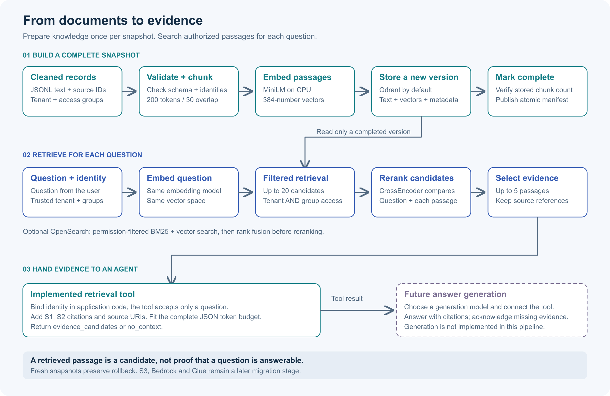

# From cleaned documents to useful evidence

This project builds a searchable knowledge library on your laptop. Give it cleaned documents, then ask a question: it returns the passages most likely to help, together with their source references, while respecting the requesting user's tenant and access groups.

For example, a support user asks **“How long do I have to request a refund?”** The pipeline can retrieve the policy saying **“within 30 days of purchase”**, even when the question and document use different wording. That user must not receive the HR payroll policy or another tenant's refund policy.

The implemented pipeline ends at **retrieved evidence and an agent tool**. Connecting a language model to turn that evidence into a written answer is a future integration. You can test indexing, retrieval and reranking without a generation model or paid API.

## The end-to-end flow



[Open the full-size diagram](docs/images/vector-rag-end-to-end.png) · [Editable SVG](docs/images/vector-rag-end-to-end.svg)

Read the diagram in three parts: **prepare the library**, **search it for each question**, then **hand the evidence to an agent**. The first part runs when your documents change. The second part runs whenever someone asks a question. The third part is available when you connect the retrieval tool to an application.

## 1. Prepare the library

Think of ingestion as preparing a reference library: check the books, split them into useful passages, and build a catalogue that can search by meaning.

### Start with cleaned text and its identity

The input is JSON Lines: one complete document per line. Extraction from PDFs, Office files or web pages happens before this pipeline. A cleaned document looks like this:

```json
{
  "doc_id": "refund-policy",
  "tenant_id": "demo",
  "title": "Refund policy",
  "text": "Customers can request a refund within 30 days of purchase. A receipt or order number is required. Refunds return to the original payment method.",
  "source_uri": "kb://policies/refunds",
  "updated_at": "2026-11-01T12:00:00Z",
  "allowed_groups": ["support"]
}
```

The text is what we want to search. The remaining fields tell us **which document it belongs to, who may read it, and where to cite it**. `doc_id` stays stable when a document changes and is unique within its tenant. A `source_uri` is a reference; the pipeline does not fetch that address automatically.

The complete sample is in [data/cleaned/documents.jsonl](data/cleaned/documents.jsonl). The reader validates the entire input before creating an index. Missing required fields, blank values, empty access lists and duplicate tenant/document identities are rejected.

### Split documents into passages

Searching an entire long document can return too much unrelated material. The chunker breaks it into smaller passages so retrieval can point to the relevant section.

The default target is **200 tokens per chunk with 30 tokens of overlap**. Tokens are the model's units of text, not necessarily whole words. Overlap repeats some nearby text so a useful explanation is less likely to lose its context at a boundary. A short policy can remain a single chunk.

Each chunk keeps its document identity, title, source URI and access groups. It also receives a deterministic chunk ID, its position and a content hash. Running the same text through the same transformation produces the same chunk IDs.

### Turn each passage into a searchable vector

The local MiniLM model converts each passage into **384 numbers**, called an embedding. Think of an embedding as a location in a space where text with related meaning tends to lie nearby. It is a search representation, not a written answer.

The model runs on CPU. Its tokenizer checks that passages fit the model's capacity rather than silently discarding overlong text. Model revisions are pinned in [validation.py](validation.py), and the first load downloads the public model weights.

### Store the text alongside the vector

Qdrant is the default local store. Each searchable point contains:

| Stored information | Why it is needed |
|---|---|
| Embedding vector | Find passages close to the question in meaning. |
| Original passage text | Return readable evidence and pass it to the reranker. |
| Tenant and allowed groups | Restrict the search before evidence leaves the store. |
| Document/chunk IDs, source URI and title | Trace the result to its source and build citations. |
| Position, content hash and update metadata | Identify the passage and retain source provenance. |

Vectors do not replace the text. Retrieval uses the numbers to find candidates; people, the reranker and the eventual agent use the original passages.

### Publish completion only after checking the build

Every ingestion creates a **fresh named collection**, such as `knowledge_v1`. Once all chunks are written and the stored count matches the expected count, ingestion atomically writes a completion manifest.

That manifest records the embedding/chunk contract, document count, chunk count and source hash. A retriever requires a matching manifest and stored count before serving the collection. A failed build has no completion marker and cannot be served through the retriever.

## 2. Search the library for a question

Now the library is ready. Follow the support user's refund question through a query:

1. **Check the question.** Reject blank or oversized questions. The local baseline accepts up to 64 embedding-model tokens.
2. **Embed it with the same model.** The question becomes a vector in the same space as the stored passages. Mixing models would make those positions incompatible, even if their dimensions matched.
3. **Search only authorized passages.** The store requires the correct tenant **and** at least one matching access group, then returns up to 20 nearest candidates.
4. **Read the candidates more closely.** The CrossEncoder receives the original question paired with each candidate passage and assigns a relevance score. This is reranking: a more focused second comparison after the broad vector search.
5. **Return up to five passages.** The result includes candidate and selected passages, source metadata, scores and timings for embedding, search and reranking.

For `tenant=demo` and `groups=[support]`, the refund and delivery policies are eligible. The HR payroll policy is excluded by group, and the other tenant's 90-day policy is excluded by tenant. These restrictions apply **before reranking**, so unauthorized passages do not reach that model.

Reranking can change which candidates come first, but it cannot recover a passage that retrieval never found. Use `--no-rerank` to compare the two approaches. Scores express model-specific ranking signals, not calibrated probabilities.

## 3. Hand evidence to an agent

The CLI prints retrieval JSON. [agent_tool.py](agent_tool.py) provides the application-facing wrapper that turns selected passages into labelled evidence such as `S1` and `S2`.

The application creates the tool with the authenticated user's tenant and groups. The agent's tool schema accepts **only the question**; it cannot choose a tenant or grant itself extra groups. Create a separate tool binding for each principal and close the retriever when its session ends.

The wrapper includes document and chunk IDs, title, source URI and passage text. It checks the **complete serialized tool response**, including citation metadata, against a token budget using the generation model's actual tokenizer. The default evidence allowance is 2,500 tokens; system instructions, conversation, tool schemas and the answer need their own reserved capacity.

An illustrative evidence item looks like this; IDs and text are shortened for readability:

```json
{
  "status": "evidence_candidates",
  "evidence": [
    {
      "citation": "S1",
      "doc_id": "refund-policy",
      "chunk_id": "<deterministic chunk UUID>",
      "title": "Refund policy",
      "source_uri": "kb://policies/refunds",
      "text": "Customers can request a refund within 30 days of purchase. ..."
    }
  ]
}
```

A future connected agent could use that passage to answer, “You can request a refund within 30 days of purchase [S1].” **That sentence illustrates the intended handoff; this project does not currently generate answers.** The generator should cite evidence, acknowledge missing information and treat source text as untrusted data that cannot redefine permissions or execute actions.

`evidence_candidates` means passages were found, not that they prove an answer. An unrelated question can still have nearest neighbors. The tool returns `no_context` when no selected evidence fits its budget; calibrated relevance-based abstention is not implemented.

## Try the full local path

Run these commands from this directory. Python 3.11 is the tested runtime.

### Install the resolved dependencies

```bash
uv venv --python 3.11
uv pip install --python .venv/bin/python -r requirements.txt
uv pip check --python .venv/bin/python
```

### Build a snapshot

```bash
.venv/bin/python rag_local.py ingest \
  --collection knowledge_v1 \
  --input data/cleaned/documents.jsonl
```

Choose a fresh collection name if `knowledge_v1` already exists. The supplied snapshot has four documents; short documents can each produce one chunk. Inspect the returned manifest for the actual counts.

### Ask a question

```bash
.venv/bin/python rag_local.py query \
  --collection knowledge_v1 \
  --question 'How long do I have to request a refund?' \
  --tenant demo \
  --groups support
```

Inspect `selected` for the refund passage and its source reference. Add `--no-rerank` to run the same question using vector ranking alone. Tenant and group flags simulate a trusted identity for local experiments; a real application must derive them from authentication.

The default state is under `.state/qdrant` and `.state/manifests`. `--state-dir` selects another directory. Embedded Qdrant permits one process to own its directory at a time, so finish one command before opening another process against the same state.

### Compare retrieval and reranking

```bash
.venv/bin/python evaluate.py \
  --collection knowledge_v1 \
  --output reports/my-evaluation.json
```

The evaluator warms the retriever, runs the same labelled questions with and without reranking, and compares:

| Measurement | What it tells you |
|---|---|
| Candidate recall | Did the initial search find the labelled relevant documents? |
| Final recall | Did the selected evidence retain those documents? |
| Mean reciprocal rank | How early does the first relevant document appear? |
| Authorization violations | Did any result violate the query's tenant or group restrictions? |
| Stage p50/p95 latency | Where is warm query time spent? Startup is recorded separately. |

Document metrics deduplicate multiple chunks from one document. Questions with no relevant-document labels have undefined recall/MRR and are reported separately.

The saved [Qdrant report](reports/toy-evaluation.json) and [OpenSearch hybrid report](reports/opensearch-hybrid-evaluation.json) use the four-document, three-question toy fixture. They are functional evidence, not held-out quality or production performance evidence. A reviewed 30–50-question corpus and an agreed latency budget remain necessary for quality acceptance.

## What happens when a document changes?

Supply a complete updated snapshot and build a new version:

```bash
.venv/bin/python rag_local.py ingest \
  --collection knowledge_v2 \
  --input data/cleaned/documents.jsonl
```

Then explicitly query `knowledge_v2`. Documents omitted from the new complete snapshot have no chunks in that version; shortened documents leave no old trailing passages there. The old `knowledge_v1` remains available for rollback.

This works only when the input is the **complete authoritative snapshot**. A partial export must not be treated as a deletion instruction. There is no automatic reader promotion, incremental synchronization or cross-version access-revocation mechanism. If permissions change, applications must move readers to the updated completed version; old versions retain their old access metadata.

Changing the embedding model, its revision or chunk settings also requires a new build. The retriever rejects an incompatible contract rather than searching old vectors with a new model.

## Use local OpenSearch instead of Qdrant

OpenSearch is the optional second storage backend. It keeps the same embedding and reranking models, so you can examine storage-engine differences without changing the entire pipeline.

The pinned development container binds to loopback and disables authentication. Start it, wait until the engine accepts requests on port 9200, then build its own index:

```bash
docker compose up -d
.venv/bin/python rag_local.py ingest \
  --backend opensearch \
  --collection knowledge_v1 \
  --input data/cleaned/documents.jsonl
.venv/bin/python rag_local.py query \
  --backend opensearch \
  --collection knowledge_v1 \
  --question 'What is the refund deadline?' \
  --tenant demo \
  --groups support \
  --hybrid
```

Without `--hybrid`, OpenSearch uses vector retrieval. With it, the adapter also searches by words using BM25, combines both lists through reciprocal rank fusion, and then reranks the merged candidates. This allows comparison of meaning-based matches with exact-word matches such as identifiers. Both branches enforce the same tenant and group filters.

```bash
.venv/bin/python evaluate.py \
  --backend opensearch \
  --collection knowledge_v1 \
  --hybrid \
  --output reports/my-hybrid-evaluation.json
docker compose down
```

Use `--opensearch-url` for a different loopback port. The Compose volume preserves indexes after shutdown. Backend-specific manifests prevent a Qdrant collection and an OpenSearch index with the same name from sharing a completion marker. Bulk item failures abort ingestion completion.

## Check the implementation

```bash
.venv/bin/python -m pytest -q
RAG_MODEL_TESTS=1 .venv/bin/python -m pytest tests/test_models.py -q
RAG_OPENSEARCH_URL=http://localhost:9200 .venv/bin/python -m pytest tests/test_opensearch_live.py -q
```

Default tests use deterministic inference substitutes and real embedded Qdrant. Model tests opt into the pinned CPU models; live engine tests require a running local OpenSearch instance and create/delete only their own unique index. See [implementation evidence](docs/tasks/2026-11-02-local-vector-rag/summary.md) for the recorded execution and limitations.

## Where each responsibility lives

| File | Responsibility |
|---|---|
| [validation.py](validation.py) | Validate cleaned documents, configuration and questions. |
| [rag_local.py](rag_local.py) | Chunk, embed, ingest, persist in Qdrant, retrieve, rerank and expose the CLI. |
| [opensearch_store.py](opensearch_store.py) | Store/search in local OpenSearch and fuse lexical/vector ranks. |
| [agent_tool.py](agent_tool.py) | Bind trusted identity and package budgeted evidence with citations. |
| [metrics.py](metrics.py) / [evaluate.py](evaluate.py) | Measure document relevance and compare ranking modes. |
| [requirements.txt](requirements.txt) / [requirements.in](requirements.in) | Resolved package versions and direct dependencies. |
| [compose.yaml](compose.yaml) | Run the optional local OpenSearch engine. |

For structural details, read [ARCHITECTURE.md](ARCHITECTURE.md) and [code-map.yaml](code-map.yaml). The original [implementation plan](local-vector-rag-implementation-plan.md) explains the wider roadmap.

## How this leads to Glue and AWS

The current local loop lets you inspect evidence and measure behavior before introducing cloud infrastructure. The later migration in the plan replaces adapters while preserving document identity, authorization, provenance and completion checks:

| Local component | Planned cloud counterpart |
|---|---|
| Cleaned JSONL on disk | Versioned cleaned records in S3. |
| Local ingestion command | Glue-orchestrated ingestion with controlled work and replay. |
| MiniLM embeddings | An evaluated Bedrock embedding provider and a fully rebuilt vector index. |
| Local OpenSearch | An appropriately authenticated AWS OpenSearch deployment. |
| Local completion manifest and explicit version selection | Verified cloud completion and deployment-specific promotion/rollback. |

**S3, Bedrock and Glue adapters, cloud deployment, and generated agent answers remain future work.** The implemented result is a local, inspectable retrieval pipeline and an agent-ready evidence tool.
