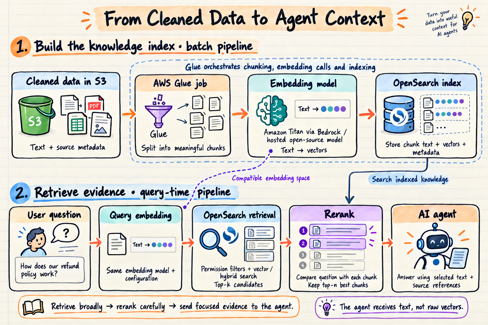

# Local vector retrieval pipeline

- **Build a searchable library from cleaned documents.** Validate the text, split it into passages and store each passage with its source and access permissions.
- **Search by meaning.** Embeddings turn passages and questions into comparable vectors, so “What is the refund deadline?” can find “within 30 days of purchase.”
- **Find broadly, then read closely.** Retrieve up to 20 authorized candidates, rerank question–passage pairs and return up to five passages.
- **Keep evidence traceable.** Return original text, document IDs and source references; the agent tool adds citation labels and applies a context budget.
- **Start locally.** CPU models and embedded Qdrant provide the baseline; local OpenSearch adds a dense and keyword-search comparison.
- **Current boundary:** retrieval and the agent tool are implemented. Generated answers and S3/Bedrock/Glue migration remain future work.

## End-to-end flow



1. **Prepare knowledge when documents change:** cleaned JSONL → validate → chunk → embed → write a fresh collection → verify counts → publish its completion manifest.
2. **Retrieve for each question:** question + trusted identity → embed question → tenant/group-filtered search → rerank → select passages and retain provenance.
3. **Hand evidence to an agent:** bind the authenticated principal in application code, label sources and fit the serialized evidence into the generator's token budget. Connecting a generator is a separate step.

For a support user in tenant `demo`, the refund policy can be retrieved; the HR payroll policy and another tenant's refund policy must be excluded **before reranking**. Finding a nearby passage does not prove that a question is answerable.

## Complexity to tackle for a production-ready system

- **Secure access:** authenticate users, enforce tenant/group isolation and propagate permission revocations across indexes and caches.
- **Reliable updates:** handle extraction, deletions, retries and partial failures; version indexes and models with safe promotion and rollback.
- **Quality and safety:** evaluate on realistic held-out questions, verify citations and abstention, and protect against instructions embedded in retrieved text.
- **Scale and operations:** control concurrency, latency, quotas and cost; add monitoring, recovery and secure AWS/Glue integrations.

## Code and file references

| File / directory | What to read it for |
|---|---|
| [rag_local.py](rag_local.py) | CLI, token-aware chunking, CPU embeddings, Qdrant, snapshot ingestion, retrieval and CrossEncoder reranking. |
| [validation.py](validation.py) | Cleaned-document schema, configuration, input validation and question limits. |
| [opensearch_store.py](opensearch_store.py) | Local OpenSearch mappings, bulk writes, filtered vector/BM25 search and reciprocal rank fusion. |
| [agent_tool.py](agent_tool.py) | Trusted-identity binding, question-only tool schema, citations and exact serialized-response token budget. |
| [metrics.py](metrics.py) / [evaluate.py](evaluate.py) | Document-level recall/MRR, paired ranking comparisons and stage latency reports. |
| [data/cleaned/documents.jsonl](data/cleaned/documents.jsonl) | Four example source documents with tenant and group metadata. |
| [data/eval/questions.jsonl](data/eval/questions.jsonl) | Toy question set with relevant-document labels. |
| [tests](tests) / [tests_support.py](tests_support.py) | Validation, persistence, lifecycle, access boundaries, tool budgets and optional real-model/engine checks. |
| [requirements.in](requirements.in) / [requirements.txt](requirements.txt) | Direct dependencies and resolved package versions. |
| [compose.yaml](compose.yaml) | Optional loopback-only development OpenSearch container. |

### Input and defaults

Each JSONL line contains `doc_id`, `tenant_id`, `title`, `text`, `source_uri`, `updated_at` and a nonempty `allowed_groups` list. Document IDs are unique within a tenant and stable across updates. Source URIs identify evidence; they are not automatically fetched.

| Setting | Default |
|---|---|
| Runtime | Python 3.11; CPU inference. |
| Embeddings | `sentence-transformers/all-MiniLM-L6-v2`, 384 dimensions. |
| Reranker | `cross-encoder/ms-marco-MiniLM-L6-v2`. |
| Chunking | 200-token target; 30-token overlap. |
| Retrieval / selection | Up to 20 candidates / five selected passages. |
| Agent evidence budget | 2,500 tokens using the caller-supplied generator tokenizer. |
| Local state | `.state/qdrant` and backend-specific `.state/manifests`. |

Model revisions are pinned in `Config`. Changing the embedding model/revision or chunk settings requires a new index; equal vector dimensions do not make different models compatible. Model scores are ranking signals, not calibrated probabilities.

## Setup and local execution

Run these commands from this project directory. The first model load downloads public weights; no generation API key is required.

### Install

```bash
uv venv --python 3.11
uv pip install --python .venv/bin/python -r requirements.txt
uv pip check --python .venv/bin/python
```

### Ingest a complete snapshot, then query it

```bash
.venv/bin/python rag_local.py ingest \
  --collection knowledge_v1 \
  --input data/cleaned/documents.jsonl

.venv/bin/python rag_local.py query \
  --collection knowledge_v1 \
  --question 'How long do I have to request a refund?' \
  --tenant demo \
  --groups support
```

Choose a fresh collection name if `knowledge_v1` exists. Inspect `selected` for passages and source metadata; add `--no-rerank` to compare vector-only ranking. Tenant/groups are local simulation parameters; applications must obtain them from authentication.

Use a new collection such as `knowledge_v2` for an updated **complete authoritative snapshot**, then explicitly move readers to it. Partial exports must not act as deletion instructions. Previous collections remain available for explicit rollback. A missing completion manifest, incompatible contract or mismatched stored count prevents serving through the retriever.

Use `--state-dir` for another storage directory. Run one process at a time against embedded Qdrant's directory.

### Evaluate and test

```bash
.venv/bin/python evaluate.py \
  --collection knowledge_v1 \
  --output reports/my-evaluation.json

.venv/bin/python -m pytest -q
RAG_MODEL_TESTS=1 .venv/bin/python -m pytest tests/test_models.py -q
```

Evaluation compares retrieval with and without reranking. Document metrics deduplicate chunks; empty relevance labels have undefined recall/MRR and are reported separately. Default tests use deterministic inference substitutes with real Qdrant; model tests explicitly opt into pinned CPU models.

### Optional local OpenSearch

Start the development container and wait until it accepts requests on port 9200 before ingesting:

```bash
docker compose up -d

.venv/bin/python rag_local.py ingest \
  --backend opensearch \
  --collection knowledge_v1 \
  --input data/cleaned/documents.jsonl

.venv/bin/python rag_local.py query \
  --backend opensearch \
  --collection knowledge_v1 \
  --question 'What is the refund deadline?' \
  --tenant demo \
  --groups support \
  --hybrid

.venv/bin/python evaluate.py \
  --backend opensearch \
  --collection knowledge_v1 \
  --hybrid \
  --output reports/my-hybrid-evaluation.json

RAG_OPENSEARCH_URL=http://localhost:9200 .venv/bin/python -m pytest tests/test_opensearch_live.py -q

docker compose down
```

`--hybrid` combines independently permission-filtered BM25 and vector ranks before reranking. Omit it for dense retrieval. Use `--opensearch-url` for another loopback port. The development container disables authentication and preserves indexes in a Compose volume; it is not a production security configuration. Live tests create/delete only their own unique index.

### Agent integration

Call `agent_tool.make_retrieval_tool(retriever, tenant_id, groups, generator_tokenizer, context_budget)` with a trusted principal and the actual generator tokenizer. Bind one tool per principal and close the retriever when its session ends. Budget separately for instructions, conversation, tool schemas and generation.

The tool returns cited evidence, not generated answers. `evidence_candidates` does not establish answerability; `no_context` means no selected evidence fits the budget. Retrieved text remains untrusted input.
