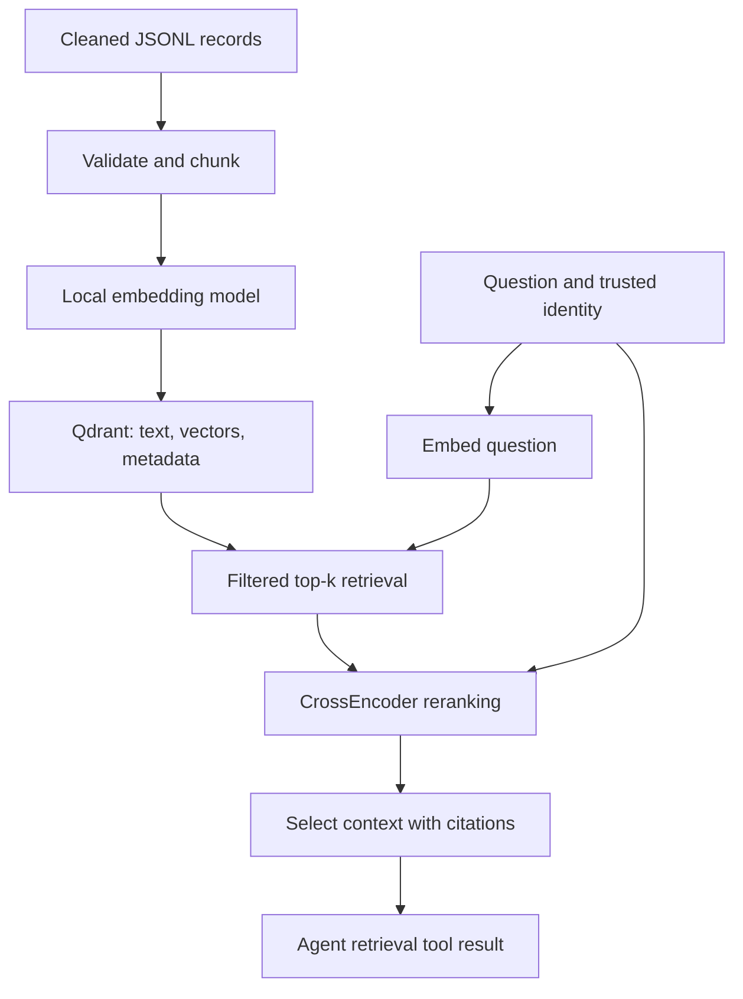

# Local-first vector retrieval pipeline: implementation plan

Start with cleaned records on disk, embed and index them locally, retrieve candidates, rerank them, and hand the selected evidence to an agent. Once the retrieval behavior is measurable, replace the local store with local OpenSearch, then introduce S3, Glue and Bedrock.

Research checked: 2 November 2026. The recommendations below are engineering choices based on the linked primary documentation, not a measured ranking of library popularity. Code is an implementation blueprint; model downloads, dependency resolution and end-to-end inference must be validated on your laptop.

## 1. Recommended starting stack

| Responsibility | Start with | Why this fits |
|---|---|---|
| Runtime | Python 3.11, `uv` | Straightforward environment management and compatibility target. |
| Input contract | JSON Lines, Pydantic | One validated cleaned document per line, easily replaced by S3 input later. |
| Chunking | `langchain-text-splitters` | Reusable, tokenizer-aware recursive splitting without introducing an agent framework around ETL. |
| Embeddings | `sentence-transformers` with `sentence-transformers/all-MiniLM-L6-v2` | Small English baseline that can run on CPU; produces 384-dimensional vectors. |
| Local vector store | `qdrant-client` embedded mode | Persistent local files and metadata filtering without a database server. |
| Reranking | `sentence-transformers.CrossEncoder`, `cross-encoder/ms-marco-MiniLM-L6-v2` | A separate question–passage relevance stage. |
| Validation | `pytest`, a small human-labelled retrieval dataset | Verify access filtering, indexing behavior and evidence quality. |
| Agent integration | `langchain-core` tool interface | Expose retrieval as one tool once retrieval itself works. |
| Second storage stage | Local OpenSearch + `opensearch-py` | Validate the actual production search engine before AWS. |
| AWS adapters later | `boto3`, `opensearch-py` | S3 reads, Bedrock model calls and signed indexing requests. |

The MiniLM embedding model's card documents 384-dimensional embeddings and default truncation beyond 256 word pieces. Begin with 200-token chunks and 30-token overlap, then measure your own corpus. Do not use a generic 1,000-token chunk setting with this model. [S1]

Sentence Transformers documents the retrieve-then-rerank architecture: retrieve a candidate set cheaply, then score each question–passage pair with a CrossEncoder. The reranker cannot recover evidence that was never retrieved. [S2]

### Why Qdrant first, even though the destination is OpenSearch?

| Option | Appropriate use | Trade-off for this project |
|---|---|---|
| **Qdrant embedded — recommended first** | Small local functional experiments with persistent vectors and payload filters | Not an OpenSearch emulator; embedded mode does exact search rather than reproducing production ANN behavior. |
| Chroma | Quick local application prototypes with document and metadata storage | Also suitable; changing stores later still requires adapter and behavior tests. |
| FAISS | Vector-search experiments and custom index research | A search library; you implement more of the document metadata, access filtering and lifecycle yourself. |
| Local OpenSearch | Validate mappings, bulk indexing, BM25 and ANN behavior | More operational setup and memory; use after the smallest retrieval loop works, or start here if your laptop can comfortably support it. |

Qdrant's client supports local mode with a filesystem path. Chroma supports local use, and FAISS is a dense-vector similarity-search library. These are established options; choosing Qdrant here is about the local learning path, not claiming it is universally the most popular. [S3–S5]

## 2. Scope and architecture

Assume extraction and cleaning are complete. The initial program accepts cleaned text plus source metadata, not arbitrary PDF/Office binaries. A local directory represents your cleaned S3 prefix. You do not need Spark, Glue, an S3 emulator, a GPU, a paid embedding API or an LLM to validate the first retrieval stages.



The initial defaults are **retrieve 20 candidates → rerank → return up to 5 chunks**. These are experimental settings, not universal optimums. If only three authorized chunks exist, return three.

### Keep responsibilities separate

- The ingestion job prepares searchable knowledge. It does not answer questions.
- The embedding model maps text into a vector space. It does not retrieve documents.
- The vector store finds candidate chunks and enforces metadata filters.
- The reranker compares the original question with candidate text.
- The agent receives readable text and provenance, and decides how to use that evidence.

LangChain is useful for splitters, tool schemas and later model integration. This pipeline is a deterministic workflow; LangGraph and a multi-agent design are optional later additions for conditional retrieval or multi-step investigation.

## 3. Repository and installation

Use this target layout. The baseline below intentionally keeps the implementation in one module so you can copy and run it; split it into adapters and services after validating it.

```text
vector-pipeline/
  requirements.txt
  rag_local.py
  tests/test_pipeline.py
  data/cleaned/documents.jsonl
  data/eval/questions.jsonl
  .state/qdrant/
  .state/manifests/
```

Create the environment:

```bash
uv venv --python 3.11
```

Initial `requirements.txt`:

```text
qdrant-client
sentence-transformers
langchain-text-splitters
langchain-core
pydantic
pytest
```

Then install and validate dependencies:

```bash
uv pip install -r requirements.txt
uv pip check
```

Do not invent fixed version numbers. Resolve the current packages on your platform, run the checks in this plan, then replace the exploratory requirements with the resolved versions:

```bash
uv pip freeze > requirements.txt
```

Commit that resulting file. For a more formal workflow, `uv pip compile` can produce a resolved requirements file from input dependencies. [S6]

The first model load downloads weights from Hugging Face; subsequent runs use the local cache. CPU execution is the baseline. If PyTorch installation causes platform-specific problems, use the appropriate official PyTorch installation instructions rather than selecting a random wheel. Before declaring reproducibility, record immutable model revisions as well as package versions.

## 4. Define the cleaned-data contract

Each JSONL line represents one source document. `doc_id` must remain stable across updates. It is unique within a tenant. `allowed_groups` carries access metadata supplied by a trusted ingestion process.

`data/cleaned/documents.jsonl`:

```jsonl
{"doc_id":"refund-policy","tenant_id":"demo","title":"Refund policy","text":"Customers can request a refund within 30 days of purchase. A receipt or order number is required. Refunds return to the original payment method.","source_uri":"kb://policies/refunds","updated_at":"2026-11-01T12:00:00Z","allowed_groups":["support"]}
{"doc_id":"delivery-policy","tenant_id":"demo","title":"Delivery policy","text":"Standard delivery takes three to five business days. Express delivery takes one business day. Delivery delays do not automatically change refund eligibility.","source_uri":"kb://policies/delivery","updated_at":"2026-11-01T12:00:00Z","allowed_groups":["support"]}
{"doc_id":"payroll-policy","tenant_id":"demo","title":"Payroll policy","text":"Payroll corrections must be submitted to HR. The payroll review window is seven days after the payslip is issued.","source_uri":"kb://hr/payroll","updated_at":"2026-11-01T12:00:00Z","allowed_groups":["hr"]}
{"doc_id":"other-refunds","tenant_id":"other","title":"Other tenant refunds","text":"This tenant permits refunds within 90 days.","source_uri":"kb://other/refunds","updated_at":"2026-11-01T12:00:00Z","allowed_groups":["support"]}
```

A missing or empty access list is rejected. In production, authentication middleware derives the tenant and groups; a question or model-generated tool argument must never choose them. Source URIs are identifiers and citation targets, not instructions to fetch arbitrary URLs.

## 5. Baseline implementation: `rag_local.py`

This baseline uses a **fresh versioned collection for every complete ingestion**. This deliberately avoids pretending that upsert alone handles deleted or shortened documents. A failed build is discarded and rebuilt under a new collection name. Readers use the previous completed version until the new version passes validation.

For small local corpora this is easier to reason about than distributed incremental synchronization. Incremental ingestion is a later milestone.

```python
from __future__ import annotations

import argparse
import hashlib
import json
import time
import uuid
from dataclasses import dataclass
from pathlib import Path
from typing import Any

from pydantic import BaseModel, ConfigDict, Field, field_validator
from qdrant_client import QdrantClient, models


class CleanDocument(BaseModel):
    model_config = ConfigDict(extra="forbid")

    doc_id: str = Field(min_length=1)
    tenant_id: str = Field(min_length=1)
    title: str = Field(min_length=1)
    text: str = Field(min_length=1)
    source_uri: str = Field(min_length=1)
    updated_at: str = Field(min_length=1)
    allowed_groups: list[str] = Field(min_length=1)

    @field_validator("doc_id", "tenant_id", "title", "text", "source_uri",
                     "updated_at")
    @classmethod
    def reject_blank(cls, value: str) -> str:
        if not value.strip():
            raise ValueError("Field must contain non-whitespace text")
        return value

    @field_validator("allowed_groups")
    @classmethod
    def validate_groups(cls, groups: list[str]) -> list[str]:
        if any(not group.strip() for group in groups):
            raise ValueError("Access group names must not be blank")
        return sorted(set(groups))


@dataclass(frozen=True)
class Config:
    collection: str
    state_dir: Path = Path(".state")
    embedding_model: str = "sentence-transformers/all-MiniLM-L6-v2"
    reranker_model: str = "cross-encoder/ms-marco-MiniLM-L6-v2"
    # Set immutable Hugging Face commit hashes after initial exploration.
    embedding_revision: str | None = None
    reranker_revision: str | None = None
    chunk_tokens: int = 200
    overlap_tokens: int = 30
    embedding_batch: int = 32
    retrieval_k: int = 20
    final_n: int = 5

    def __post_init__(self) -> None:
        if not self.collection or any(
            char not in "abcdefghijklmnopqrstuvwxyz0123456789_-"
            for char in self.collection
        ):
            raise ValueError("Use a lowercase collection name with digits, _ or -")
        if not 0 <= self.overlap_tokens < self.chunk_tokens:
            raise ValueError("Overlap must be smaller than chunk size")
        if not 1 <= self.final_n <= self.retrieval_k:
            raise ValueError("Require 1 <= final_n <= retrieval_k")
        if self.embedding_batch < 1:
            raise ValueError("Embedding batch size must be positive")


def read_documents(path: Path) -> list[CleanDocument]:
    """Validate the complete small input before modifying the vector store."""
    documents = []
    seen = set()
    with path.open(encoding="utf-8") as handle:
        for line_number, line in enumerate(handle, start=1):
            if not line.strip():
                continue
            try:
                document = CleanDocument.model_validate_json(line)
            except ValueError as exc:
                raise ValueError(f"Invalid record on line {line_number}") from exc
            identity = (document.tenant_id, document.doc_id)
            if identity in seen:
                raise ValueError(f"Duplicate document identity: {identity}")
            seen.add(identity)
            documents.append(document)
    if not documents:
        raise ValueError("No cleaned documents found")
    return documents


class LocalEmbedder:
    def __init__(self, config: Config):
        # Import and load lazily so schema and store tests need no model download.
        from sentence_transformers import SentenceTransformer

        self.model = SentenceTransformer(
            config.embedding_model,
            revision=config.embedding_revision,
            device="cpu",
        )
        self.tokenizer = self.model.tokenizer
        self.dimension = int(self.model.get_sentence_embedding_dimension())
        self.max_tokens = int(self.model.max_seq_length)
        self.batch_size = config.embedding_batch

    def token_count(self, text: str) -> int:
        return len(self.tokenizer.encode(text, add_special_tokens=True))

    def encode(self, texts: list[str]) -> list[list[float]]:
        if not texts:
            return []
        # Fail rather than silently losing document content to model truncation.
        if any(self.token_count(text) > self.max_tokens for text in texts):
            raise ValueError("Embedding input exceeds the model token limit")
        vectors = self.model.encode(
            texts,
            batch_size=self.batch_size,
            normalize_embeddings=True,
            show_progress_bar=False,
            convert_to_numpy=True,
        )
        return vectors.tolist()


def build_chunks(documents: list[CleanDocument], config: Config,
                 embedder: LocalEmbedder) -> list[dict[str, Any]]:
    from langchain_text_splitters import RecursiveCharacterTextSplitter

    if config.chunk_tokens + 2 > embedder.max_tokens:
        raise ValueError("Chunk budget exceeds the embedding model capacity")
    splitter = RecursiveCharacterTextSplitter.from_huggingface_tokenizer(
        embedder.tokenizer,
        chunk_size=config.chunk_tokens,
        chunk_overlap=config.overlap_tokens,
    )
    chunks = []
    for document in documents:
        for position, text in enumerate(splitter.split_text(document.text)):
            if not text.strip():
                continue
            if embedder.token_count(text) > embedder.max_tokens:
                raise ValueError("Splitter produced an oversized chunk")
            # IDs are deterministic within this ingestion contract. Including
            # tenant prevents identical source IDs from colliding across tenants.
            identity = json.dumps(
                [document.tenant_id, document.doc_id, position, text],
                ensure_ascii=False,
            )
            chunk_id = str(uuid.uuid5(uuid.NAMESPACE_URL, identity))
            payload = document.model_dump(exclude={"text"})
            chunks.append({
                **payload,
                "chunk_id": chunk_id,
                "position": position,
                "text": text,
                "content_sha256": hashlib.sha256(text.encode()).hexdigest(),
            })
    if not chunks:
        raise ValueError("No indexable chunks were produced")
    return chunks


class LocalStore:
    def __init__(self, config: Config):
        config.state_dir.mkdir(parents=True, exist_ok=True)
        self.collection = config.collection
        self.client = QdrantClient(path=str(config.state_dir / "qdrant"))

    def create_empty(self, dimension: int) -> None:
        # Never erase an existing collection as a side effect of ingestion.
        if self.client.collection_exists(self.collection):
            raise ValueError("Collection exists; choose a fresh version name")
        self.client.create_collection(
            collection_name=self.collection,
            vectors_config=models.VectorParams(
                size=dimension, distance=models.Distance.COSINE,
            ),
        )

    def upsert(self, chunks: list[dict], vectors: list[list[float]]) -> None:
        points = [
            models.PointStruct(id=chunk["chunk_id"], vector=vector, payload=chunk)
            for chunk, vector in zip(chunks, vectors, strict=True)
        ]
        self.client.upsert(
            collection_name=self.collection, points=points, wait=True,
        )

    def count(self) -> int:
        return self.client.count(
            collection_name=self.collection, exact=True,
        ).count

    def search(self, vector: list[float], tenant_id: str,
               groups: list[str], k: int) -> list[dict]:
        if not tenant_id or not groups:
            return []  # Fail closed for missing identity information.
        access_filter = models.Filter(must=[
            models.FieldCondition(
                key="tenant_id", match=models.MatchValue(value=tenant_id),
            ),
            models.FieldCondition(
                key="allowed_groups", match=models.MatchAny(any=groups),
            ),
        ])
        hits = self.client.query_points(
            collection_name=self.collection,
            query=vector,
            query_filter=access_filter,
            limit=k,
            with_payload=True,
            with_vectors=False,
        ).points
        return [
            {**(hit.payload or {}), "vector_score": float(hit.score)}
            for hit in hits
        ]

    def close(self) -> None:
        self.client.close()


def index_contract(config: Config, dimension: int) -> dict:
    """Identity of the vector space and chunk transformation, not query knobs."""
    return {
        "schema_version": 1,
        "embedding_model": config.embedding_model,
        "embedding_revision": config.embedding_revision,
        "dimension": dimension,
        "normalized": True,
        "distance": "cosine",
        "splitter": "recursive_huggingface_tokenizer",
        "chunk_tokens": config.chunk_tokens,
        "overlap_tokens": config.overlap_tokens,
    }


def manifest_path(config: Config) -> Path:
    return config.state_dir / "manifests" / f"{config.collection}.json"


def ingest(path: Path, config: Config) -> dict:
    documents = read_documents(path)
    embedder = LocalEmbedder(config)
    chunks = build_chunks(documents, config, embedder)
    store = LocalStore(config)
    try:
        store.create_empty(embedder.dimension)
        for start in range(0, len(chunks), config.embedding_batch):
            batch = chunks[start:start + config.embedding_batch]
            vectors = embedder.encode([chunk["text"] for chunk in batch])
            store.upsert(batch, vectors)
        if store.count() != len(chunks):
            raise RuntimeError("Indexed point count does not match chunk count")
        manifest = {
            "contract": index_contract(config, embedder.dimension),
            "document_count": len(documents),
            "chunk_count": len(chunks),
            "source_sha256": hashlib.sha256(path.read_bytes()).hexdigest(),
        }
        target = manifest_path(config)
        target.parent.mkdir(parents=True, exist_ok=True)
        temporary = target.with_suffix(".tmp")
        temporary.write_text(json.dumps(manifest, indent=2), encoding="utf-8")
        # Only publish completion after all points have been written and counted.
        temporary.replace(target)
        return manifest
    finally:
        store.close()


class Retriever:
    def __init__(self, config: Config):
        from sentence_transformers import CrossEncoder

        self.config = config
        self.embedder = LocalEmbedder(config)
        completed = json.loads(manifest_path(config).read_text(encoding="utf-8"))
        if completed["contract"] != index_contract(config, self.embedder.dimension):
            raise ValueError("Index contract mismatch; rebuild a new collection")
        self.reranker = CrossEncoder(
            config.reranker_model,
            revision=config.reranker_revision,
            device="cpu",
            max_length=512,
        )
        self.store = LocalStore(config)
        try:
            if self.store.count() != completed["chunk_count"]:
                raise ValueError("Collection no longer matches its build manifest")
        except Exception:
            self.store.close()
            raise

    def retrieve(self, question: str, tenant_id: str, groups: list[str],
                 rerank: bool = True) -> dict:
        if not question.strip():
            raise ValueError("Question must not be blank")
        # Conservative local limit also leaves room in the reranker's paired input.
        if self.embedder.token_count(question) > 64:
            raise ValueError("Local baseline accepts questions up to 64 model tokens")
        started = time.perf_counter()
        vector = self.embedder.encode([question])[0]
        embedded = time.perf_counter()
        candidates = self.store.search(
            vector, tenant_id, groups, self.config.retrieval_k,
        )
        searched = time.perf_counter()
        ordered = candidates
        if candidates and rerank:
            pairs = [(question, item["text"]) for item in candidates]
            # Check the actual paired tokenizer input; different models tokenize
            # differently, so the embedding chunk limit alone is insufficient.
            for query, passage in pairs:
                ids = self.reranker.tokenizer.encode(
                    query, passage, add_special_tokens=True, truncation=False,
                )
                if len(ids) > self.reranker.max_length:
                    raise ValueError("Question–chunk pair exceeds reranker capacity")
            scores = self.reranker.predict(pairs, batch_size=16)
            ordered = sorted(
                [{**item, "rerank_score": float(score)}
                 for item, score in zip(candidates, scores, strict=True)],
                key=lambda item: item["rerank_score"],
                reverse=True,
            )
        selected = ordered[:self.config.final_n]
        finished = time.perf_counter()
        # Full-text chunks remain in the tool result for transparent inspection.
        # The agent adapter applies its own generator-specific context budget.
        return {
            "question": question,
            "status": "evidence_candidates" if selected else "no_authorized_hits",
            "candidates": candidates,
            "selected": selected,
            "timings_ms": {
                "embedding": round((embedded - started) * 1000, 2),
                "search": round((searched - embedded) * 1000, 2),
                "rerank_and_select": round((finished - searched) * 1000, 2),
            },
        }

    def close(self) -> None:
        self.store.close()


def main() -> None:
    parser = argparse.ArgumentParser()
    parser.add_argument("command", choices=["ingest", "query"])
    parser.add_argument("--collection", required=True)
    parser.add_argument("--input", type=Path)
    parser.add_argument("--question")
    parser.add_argument("--tenant")
    parser.add_argument("--groups", nargs="+", default=[])
    parser.add_argument("--no-rerank", action="store_true")
    args = parser.parse_args()
    config = Config(collection=args.collection)
    if args.command == "ingest":
        if args.input is None:
            parser.error("ingest requires --input")
        output = ingest(args.input, config)
    else:
        if not args.question or not args.tenant or not args.groups:
            parser.error("query requires --question, --tenant and --groups")
        retriever = Retriever(config)
        try:
            output = retriever.retrieve(
                args.question, args.tenant, args.groups,
                rerank=not args.no_rerank,
            )
        finally:
            retriever.close()
    print(json.dumps(output, ensure_ascii=False, indent=2))


if __name__ == "__main__":
    main()
```

### Run the complete local path

From the project root:

```bash
.venv/bin/python rag_local.py ingest --collection knowledge_v1 --input data/cleaned/documents.jsonl
```

```bash
.venv/bin/python rag_local.py query --collection knowledge_v1 --question "How long do I have to request a refund?" --tenant demo --groups support
```

```bash
.venv/bin/python rag_local.py query --collection knowledge_v1 --question "How long do I have to request a refund?" --tenant demo --groups support --no-rerank
```

On Windows, use `.venv\Scripts\python.exe`. Inspect the two outputs. The support user must never receive HR content or the other tenant's 90-day refund policy. Do not hard-code expected numeric model scores; scores are model-specific and are not calibrated probabilities.

Run one embedded-store process at a time. Do not simultaneously run CLI ingestion and a web server against the same Qdrant local directory. Introduce Qdrant server mode or OpenSearch when concurrent processes become necessary. Local embedded search is useful for functional correctness, not a production latency or approximate-search benchmark. [S3, S7]

### Deliberate baseline limitations

- Inputs and chunks are held in memory: suitable for a small local corpus, not millions of records.
- `updated_at` is a nonblank provenance string here; enterprise ingestion should enforce timezone-aware timestamps and source-version ordering.
- `revision=None` is exploratory. Package locks, immutable model revisions and a signed build manifest are required for reproducible builds.
- No calibrated relevance threshold is included. `evidence_candidates` means results were retrieved; it does not assert that the question is answerable.
- The manifest is a local completion marker, not a distributed transaction or tamper-resistant audit record.
- Model loading time is outside query timing. Report startup and warm inference separately.
- Rebuilding a new collection handles deletion only when its input is a complete authoritative snapshot. Partial source extracts must not be treated as deletion instructions.

## 6. Meaningful tests before agent integration

Save this as `tests/test_pipeline.py`. These tests exercise persistence, access boundaries and ingestion identities without downloading model weights.

```python
import json
from pathlib import Path

import pytest

from rag_local import Config, LocalStore, read_documents


def record(doc_id="refunds", tenant="demo", groups=None):
    return {
        "doc_id": doc_id,
        "tenant_id": tenant,
        "title": "Example",
        "text": "Refunds are permitted within thirty days.",
        "source_uri": f"kb://{tenant}/{doc_id}",
        "updated_at": "2026-11-01T12:00:00Z",
        "allowed_groups": ["support"] if groups is None else groups,
    }


def test_duplicate_document_identity_fails_before_indexing(tmp_path):
    path = tmp_path / "documents.jsonl"
    path.write_text("\n".join(json.dumps(record()) for _ in range(2)))
    with pytest.raises(ValueError, match="Duplicate"):
        read_documents(path)


def test_missing_permissions_are_rejected(tmp_path):
    path = tmp_path / "documents.jsonl"
    path.write_text(json.dumps(record(groups=[])))
    with pytest.raises(ValueError, match="Invalid record"):
        read_documents(path)


def test_filtering_and_persistence(tmp_path):
    config = Config(collection="test_v1", state_dir=tmp_path)
    store = LocalStore(config)
    try:
        store.create_empty(3)
        chunks = [
            {**record("support"), "chunk_id": "00000000-0000-0000-0000-000000000001"},
            {**record("hr", groups=["hr"]), "chunk_id": "00000000-0000-0000-0000-000000000002"},
            {**record("other", tenant="other"), "chunk_id": "00000000-0000-0000-0000-000000000003"},
        ]
        # Identical vectors ensure access filtering, not semantic separation,
        # is what prevents unauthorized chunks from being returned.
        store.upsert(chunks, [[1.0, 0.0, 0.0]] * 3)
        store.upsert(chunks, [[1.0, 0.0, 0.0]] * 3)
        assert store.count() == 3  # Retry of the same IDs adds no duplicates.
    finally:
        store.close()
    reopened = LocalStore(config)
    try:
        hits = reopened.search([1.0, 0.0, 0.0], "demo", ["support"], 20)
        assert [hit["doc_id"] for hit in hits] == ["support"]
        assert reopened.search([1.0, 0.0, 0.0], "demo", [], 20) == []
        with pytest.raises(ValueError, match="fresh version"):
            reopened.create_empty(3)
    finally:
        reopened.close()
```

Run:

```bash
.venv/bin/python -m pytest -q
```

Add model-backed integration checks after downloading the models:

1. Same source input and configuration produce the same chunk IDs.
2. Every chunk fits the embedding tokenizer limit; every question–chunk pair fits the reranker.
3. Reopening the completed index preserves retrieval results.
4. A collection with no completion manifest cannot be served.
5. An altered embedding model/revision or chunk configuration fails the contract check.
6. Build `knowledge_v2` after shortening or deleting a source; verify removed text is absent from v2 while v1 remains available for rollback.
7. Introduce a failed write; verify no completion manifest is published for that collection.
8. Test Unicode, long code blocks, tables and text without spaces. Generic splitting may require content-aware handling for those formats.

## 7. Evaluate relevance, not just whether the script runs

A plausible answer can hide bad retrieval. Evaluate the evidence before introducing a generation model.

Create 30–50 manually reviewed questions spanning paraphrases, exact identifiers, conflicting sources, unanswerable questions, and different permission groups. Separate tuning examples from a held-out set. Use document IDs initially; add chunk-level relevance labels when you need to assess passage coverage.

`data/eval/questions.jsonl` example:

```jsonl
{"question":"What is the refund request deadline?","tenant_id":"demo","groups":["support"],"relevant_doc_ids":["refund-policy"]}
{"question":"When should I submit a payroll correction?","tenant_id":"demo","groups":["hr"],"relevant_doc_ids":["payroll-policy"]}
{"question":"Does this policy describe lunar delivery?","tenant_id":"demo","groups":["support"],"relevant_doc_ids":[]}
```

Evaluation definitions:

| Metric | Calculation and purpose |
|---|---|
| Candidate Recall@20 | Relevant authorized documents retrieved / all labelled relevant authorized documents. Measures what reranking has available. |
| Final Recall@5 | Relevant authorized documents retained in final context / all labelled relevant authorized documents. Measures losses at selection. |
| MRR@5 | Reciprocal rank of the first relevant result, or zero. Measures how early useful evidence appears. |
| nDCG@5, later | Useful once you have graded relevance labels. |
| Authorization violations | Any unauthorized result reaching reranking or context. Target: zero. |
| Latency | Warm p50/p95 across representative queries, broken down by embedding, search and reranking. |
| Context size | Tokens under the actual generator tokenizer, after citation formatting. |

When multiple chunks belong to one document, deduplicate document IDs before computing document-level metrics. For empty relevance labels, recall is undefined: report those queries separately, and review whether the final answer abstains correctly. Nearest-neighbor search can return results for an unrelated question.

A small reusable metric helper:

```python
# Save as metrics.py if implementing the evaluator as a separate module.
def unique_doc_ids(hits):
    return list(dict.fromkeys(hit["doc_id"] for hit in hits))


def recall_and_mrr(hits, relevant):
    ordered = unique_doc_ids(hits)
    relevant = set(relevant)
    if not relevant:
        return {"recall": None, "mrr": None}
    recall = len(set(ordered) & relevant) / len(relevant)
    mrr = next(
        (1.0 / rank for rank, doc_id in enumerate(ordered, 1)
         if doc_id in relevant),
        0.0,
    )
    return {"recall": recall, "mrr": mrr}
```

Run each answerable evaluation question twice: vector retrieval alone and retrieval with reranking. Compare paired outcomes and latency. Reranking may help some questions and hurt others; adopt it based on your evidence rather than assuming improvement.

Proposed initial gates, to adjust before testing: zero access leaks; all lifecycle tests pass; candidate document Recall@20 at least 0.90 on a suitably sized held-out set; reranking preserves or improves average MRR@5 within your agreed latency budget. These are project targets, not guarantees or industry-wide standards. A four-document toy corpus cannot establish retrieval quality.

## 8. Expose retrieval to a LangChain agent

First verify the CLI and evaluation. Then wrap the retriever as a tool. The agent supplies only the question. Tenant and groups come from the authenticated application context.

```python
from langchain_core.tools import tool


def make_retrieval_tool(retriever, tenant_id, groups, generator_tokenizer,
                        context_budget=2500):
    # Capture identity server-side. Do not put these fields in the tool schema.
    trusted_groups = tuple(groups)

    @tool
    def search_knowledge(question: str) -> dict:
        """Search authorized knowledge and return evidence with source references."""
        result = retriever.retrieve(question, tenant_id, list(trusted_groups))
        evidence = []
        for hit in result["selected"]:
            candidate = {
                "citation": f"S{len(evidence) + 1}",
                "doc_id": hit["doc_id"],
                "chunk_id": hit["chunk_id"],
                "title": hit["title"],
                "source_uri": hit["source_uri"],
                "text": hit["text"],
            }
            # Count the exact serialized evidence using the generation model's
            # tokenizer. Embedding token counts are not interchangeable with it.
            proposed = {"evidence": evidence + [candidate]}
            import json
            token_count = len(generator_tokenizer.encode(
                json.dumps(proposed, ensure_ascii=False)
            ))
            if token_count <= context_budget:
                evidence.append(candidate)
        return {
            "status": "evidence_candidates" if evidence else "no_context",
            "evidence": evidence,
        }

    return search_knowledge
```

Pass the real generator tokenizer or a provider-appropriate token-count adapter. The 2,500-token value is only the evidence allowance: reserve additional capacity for system instructions, tool schemas, conversation, the question and response. Initialize models once per process and close the retriever on application shutdown. Bind one authenticated principal per request/session; never reuse a closure captured for another user.

The generation instruction should require citations, acknowledge insufficient evidence, and treat retrieved content as untrusted data. Do not allow retrieved text to redefine tool permissions or execute actions. A generation model is optional until this step; choosing a local model server can be a separate decision based on laptop memory and answer-quality needs.

## 9. Second stage: validate local OpenSearch

Qdrant validates the workflow. OpenSearch validates the destination engine. Keep the embedding and reranking models unchanged during the store migration so you can isolate search-engine differences.

Install `opensearch-py` and add its resolved version to the same `requirements.txt`. Run a single-node Docker instance following the official Docker guide. Select and pin an available exact OpenSearch release compatible with your intended AWS version. OpenSearch documents a minimum Docker Desktop memory allocation of 4 GB; leave room for Python, models and the OS as well. [S8]

Example development container command, after setting `OPENSEARCH_IMAGE` to a verified exact image tag:

```bash
docker run --name rag-opensearch --publish 127.0.0.1:9200:9200 --env discovery.type=single-node --env DISABLE_INSTALL_DEMO_CONFIG=true --env DISABLE_SECURITY_PLUGIN=true --env "OPENSEARCH_JAVA_OPTS=-Xms1g -Xmx1g" --volume rag-opensearch-data:/usr/share/opensearch/data "$OPENSEARCH_IMAGE"
```

This intentionally disables security for an isolated loopback-only development instance. Production uses TLS, authentication and service policies. Linux hosts may need the kernel settings described by the installation guide.

### Explicit vector and metadata mappings

OpenSearch uses `knn_vector`; configure the index for ANN search and use the correct vector dimension. [S9]

```python
from opensearchpy import OpenSearch, helpers

client = OpenSearch(hosts=[{"host": "localhost", "port": 9200}], use_ssl=False)
index_name = "knowledge-v1"

mapping = {
    "settings": {"index": {"knn": True, "number_of_shards": 1,
                            "number_of_replicas": 0}},
    "mappings": {
        "properties": {
            "embedding": {
                "type": "knn_vector",
                "dimension": 384,
                "method": {"name": "hnsw", "engine": "lucene",
                           "space_type": "cosinesimil"},
            },
            "text": {"type": "text"},
            "title": {"type": "text"},
            "doc_id": {"type": "keyword"},
            "tenant_id": {"type": "keyword"},
            "allowed_groups": {"type": "keyword"},
            "source_uri": {"type": "keyword"},
            "chunk_id": {"type": "keyword"},
        }
    },
}
# Fresh index builds should fail if the name is already in use.
client.indices.create(index=index_name, body=mapping)


def index_chunks(chunks, vectors):
    actions = (
        {"_op_type": "index", "_index": index_name,
         "_id": chunk["chunk_id"],
         "_source": {**chunk, "embedding": vector}}
        for chunk, vector in zip(chunks, vectors, strict=True)
    )
    # Fail the build on item-level errors. Before production, classify failures,
    # retry transient items, and persist unrecoverable records for replay.
    helpers.bulk(client, actions, chunk_size=100, raise_on_error=True,
                 request_timeout=60)
    client.indices.refresh(index=index_name)


def retrieve_opensearch(query_vector, tenant_id, groups, k=20):
    if not tenant_id or not groups:
        return []
    body = {
        "size": k,
        "_source": {"excludes": ["embedding"]},
        "query": {"knn": {"embedding": {
            "vector": query_vector,
            "k": k,
            "filter": {"bool": {"filter": [
                {"term": {"tenant_id": tenant_id}},
                {"terms": {"allowed_groups": groups}},
            ]}},
        }}},
    }
    response = client.search(index=index_name, body=body)
    return [{**hit["_source"], "vector_score": hit["_score"]}
            for hit in response["hits"]["hits"]]
```

Efficient k-NN filtering depends on the selected engine; the query documentation supports it with Lucene and FAISS. Validate this mapping and query against your pinned OpenSearch release, including restrictive access filters. [S10]

This is a store adapter sketch, not a replacement CLI: wire `index_chunks` and `retrieve_opensearch` into the ingestion/retrieval services and preserve the same manifest and completion checks. Return the same candidate payload shape to the existing reranker.

### Add hybrid search after the dense baseline

For product IDs, API names and exact terms, compare BM25 plus vectors against vectors alone:

1. Run a permission-filtered BM25 query for the top 20.
2. Run a permission-filtered vector query for the top 20.
3. Deduplicate by `chunk_id` and fuse ranks with reciprocal rank fusion: `sum(1 / (60 + rank))`.
4. Keep the best 20 fused candidates, rerank, then select up to 5.

The value 60 is an initial fusion parameter to evaluate. Do not average raw BM25 and vector scores; their scales differ. Application-side fusion is a simple first implementation. OpenSearch's native hybrid-search pipeline is another option once version-specific behavior is tested. [S11]

## 10. Introduce narrow interfaces before AWS

After the baseline works, split the code into `app/models.py`, `app/chunking.py`, `app/embeddings.py`, `app/stores.py`, `app/ingest.py`, `app/retrieval.py` and `app/evaluate.py`. Preserve tests while moving code.

```python
from typing import Protocol


class EmbeddingProvider(Protocol):
    dimension: int

    def encode_documents(self, texts: list[str]) -> list[list[float]]: ...
    def encode_query(self, text: str) -> list[float]: ...


class VectorStore(Protocol):
    def upsert(self, chunks: list[dict], vectors: list[list[float]]) -> None: ...
    def search(self, vector: list[float], tenant_id: str,
               groups: list[str], k: int) -> list[dict]: ...


class Reranker(Protocol):
    def rank(self, question: str, candidates: list[dict]) -> list[dict]: ...
```

These are proposed target interfaces. The one-file baseline has equivalent operations with different signatures; adapt it explicitly during the refactor. Separate document and query embedding methods because some embedding models require different prompts or prefixes. MiniLM does not establish the correct input convention for every future model.

## 11. AWS migration: change adapters, preserve contracts

| Local component | AWS replacement | What to retest |
|---|---|---|
| Cleaned JSONL on disk | Versioned S3 objects; Parquet if volume justifies it | Schema, lineage, object version tracking and complete-snapshot semantics. |
| CLI ingestion | Glue job plus bounded workers, or Glue preparing Bedrock batch inputs | Retries, embedding quotas, partial failures and replay. |
| Local MiniLM | Titan Text Embeddings V2 or an evaluated hosted open-source embedding model | Entire corpus must be re-embedded; retrieval evaluation must be rerun. |
| Local OpenSearch | Amazon OpenSearch Service domain or Serverless collection | Authentication, data/network policies, engine/version support and capacity. |
| Local CrossEncoder | A deployed reranking service, or a suitable managed reranker | Payload limits, access boundaries, latency and relevance. |
| Console output | Retrieval service and agent tool | Trusted identity propagation and context budget. |

### Bedrock embedding adapter sketch

Use the AWS credential provider chain; do not embed AWS keys in code. Titan is an embedding model accessed through the model-specific Bedrock invocation API. Its dimensions and limits differ from the local MiniLM model. Titan V2 supports 1,024, 512 or 256 output dimensions; document segmentation remains necessary. [S12]

```python
import json
import boto3
from botocore.config import Config as AwsClientConfig


class TitanEmbedder:
    dimension = 1024

    def __init__(self, region_name):
        self.runtime = boto3.client(
            "bedrock-runtime",
            region_name=region_name,
            config=AwsClientConfig(
                retries={"mode": "adaptive", "max_attempts": 5},
                connect_timeout=10,
                read_timeout=60,
            ),
        )

    def encode_query(self, text):
        response = self.runtime.invoke_model(
            modelId="amazon.titan-embed-text-v2:0",
            contentType="application/json",
            accept="application/json",
            body=json.dumps({"inputText": text,
                             "dimensions": self.dimension,
                             "normalize": True}),
        )
        body = response["body"]
        try:
            vector = json.loads(body.read())["embedding"]
        finally:
            body.close()
        if len(vector) != self.dimension:
            raise ValueError("Unexpected embedding dimension")
        return vector

    def encode_documents(self, texts):
        # Correct but sequential: establish correctness before adding bounded
        # concurrency or a separate asynchronous batch-inference workflow.
        return [self.encode_query(text) for text in texts]
```

Create a new index with dimension 1,024 for this adapter. Equal vector dimensions alone do not make two models compatible. Never search a MiniLM corpus using a Titan query vector, or mix model versions within one embedding field.

### Glue execution design

1. Read cleaned S3 records with source versions and access metadata.
2. Validate and chunk using a pinned transformation package.
3. Create deterministic IDs and an embedding contract fingerprint.
4. Generate embeddings with bounded concurrency or prepare supported Bedrock batch-inference inputs.
5. Persist a replayable vector dataset to S3 when useful for large backfills.
6. Bulk-index a new versioned OpenSearch index.
7. Check per-item results, counts, access filters and retrieval evaluation.
8. Promote the completed index through the deployment mechanism supported by the chosen OpenSearch deployment; keep the prior version for rollback.

Do not call remote embedding APIs in an unbounded Spark UDF. Spark retries can repeat external side effects and aggregate executor concurrency can exceed model quotas. Prefer controlled partition-level clients, checkpointed results and deterministic IDs; coordinate total rate across workers. Titan embedding quotas are request-rate based. [S12]

AWS documents Bedrock batch inference for supported models and regions. Verify support at deployment time, and orchestrate asynchronous jobs separately from ordinary synchronous model calls. [S13]

An important connector constraint: AWS Glue's documented native OpenSearch Service connection uses credentials in Secrets Manager and is **not compatible with OpenSearch Serverless**. For a Serverless target, design an appropriate supported client/integration path instead of assuming the native Glue connector will work. [S14]

For direct AWS OpenSearch requests, use the appropriate SigV4 service name (`es` for managed domains; `aoss` for Serverless), TLS and the relevant IAM/data/network policies. Keep that authentication adapter separate from the local HTTP client. Confirm exact capabilities of the selected deployment before relying on custom document IDs, aliases or index-management operations. [S15]

## 12. Enterprise work to add deliberately

| Concern | Implementation requirement | Local validation that prepares you |
|---|---|---|
| Access revocation | Refresh ACLs promptly; prevent stale permissions from exposing text | Change source group memberships, build v2 and verify retrieval boundaries. |
| Document deletion | Remove every obsolete chunk, including shortened-document leftovers | Full snapshot rebuild and old/new index comparison. |
| Incremental updates | Track tenant, source ID, source version, content hash, ACL hash and transform version | Test repeated events, older events arriving late, and interrupted updates. |
| Embedding reuse | Cache by content, model/revision, normalization and any embedding prompt | Change one field at a time; ensure stale vectors are not reused. |
| Index promotion | Complete writes and evaluation before switching readers | Keep a completed v1 while v2 fails halfway. |
| Provenance | Preserve source URI, version, chunk ID and transformation metadata | Trace each retrieved passage back to the original cleaned record. |
| Sensitive data | Apply approved redaction and model-hosting boundaries | Use synthetic sensitive-data fixtures; verify they never enter unauthorized model calls or logs. |
| Observability | Record stage timings, counts, model versions and failures | Compare warm/cold execution and retrieval/rerank latency. |
| Cost | Measure chunks per document and changed-content embedding volume | Estimate volume from actual chunk counts rather than file counts. |
| Evaluation drift | Maintain a versioned held-out question set and ACL scenarios | Rerun it on model, chunker and index changes. |
| Prompt injection | Treat retrieved instructions as untrusted content | Include an adversarial document and ensure the agent does not follow its action requests. |
| Operational recovery | Retain failed items, successful IDs and replay checkpoints | Retry deterministic writes; verify no duplicate chunks. |

Avoid logging raw confidential passages by default. Log identifiers, stage outcomes and durations; use controlled diagnostic capture when content inspection is necessary.

## 13. Suggested implementation sequence

| Milestone | Concrete work | Completion evidence |
|---|---|---|
| 1. Input and schema | Create JSONL fixtures and validate duplicate IDs/access metadata | Input tests pass and bad data fails before indexing. |
| 2. Local indexing | Add tokenizer-aware chunking, embeddings, persistent Qdrant and manifest | Inspect chunk sizes; reopen store; confirm expected point counts. |
| 3. Retrieval and reranking | Add identity filters, top-k search, CrossEncoder and citations | Compare ranked outputs; zero unauthorized results. |
| 4. Evaluation | Label realistic questions; implement recall/MRR and stage timings | Saved baseline report and reranking comparison on held-out questions. |
| 5. Lifecycle | Build fresh index versions; test deletion, failure and rollback | Failed builds never become the serving version. |
| 6. Agent tool | Wrap retrieval with trusted identity and generator token budgeting | Agent answers with sources and handles insufficient evidence. |
| 7. Local OpenSearch | Implement mappings, bulk adapter, filtered retrieval and hybrid experiment | Same relevance and access suite passes on the target engine. |
| 8. AWS | Add S3, Bedrock and Glue with deployment-specific OpenSearch auth | Replayable ingestion, verified promotion, quota controls and operational metrics. |

The first useful deliverable is not an agent UI: it is a local command that returns relevant, authorized passages with source IDs and measurable behavior. That gives the later agent a reliable knowledge tool.

## 14. Primary references

- **[S1] MiniLM embedding model card:** https://huggingface.co/sentence-transformers/all-MiniLM-L6-v2
- **[S2] Sentence Transformers retrieve and rerank:** https://sbert.net/examples/sentence_transformer/applications/retrieve_rerank/README.html
- **[S3] Qdrant Python client and embedded mode:** https://github.com/qdrant/qdrant-client
- **[S4] Chroma getting started:** https://docs.trychroma.com/docs/overview/getting-started
- **[S5] FAISS project:** https://github.com/facebookresearch/faiss
- **[S6] uv requirements locking:** https://docs.astral.sh/uv/pip/compile/
- **[S7] Qdrant local implementation and search limitations:** https://github.com/qdrant/qdrant-client/blob/master/qdrant_client/local/qdrant_local.py
- **[S8] OpenSearch Docker installation:** https://docs.opensearch.org/latest/install-and-configure/install-opensearch/docker/
- **[S9] OpenSearch vector field mapping:** https://docs.opensearch.org/latest/mappings/supported-field-types/knn-vector/
- **[S10] OpenSearch k-NN query and filter support:** https://docs.opensearch.org/latest/query-dsl/specialized/k-nn/index/
- **[S11] OpenSearch hybrid search:** https://docs.opensearch.org/latest/vector-search/ai-search/hybrid-search/
- **[S12] Amazon Titan embeddings:** https://docs.aws.amazon.com/bedrock/latest/userguide/titan-embedding-models.html
- **[S13] Bedrock batch inference support:** https://docs.aws.amazon.com/bedrock/latest/userguide/batch-inference-supported.html
- **[S14] Glue OpenSearch Service connection and limitations:** https://docs.aws.amazon.com/glue/latest/dg/aws-glue-programming-etl-connect-opensearch-home.html
- **[S15] OpenSearch Python client authentication:** https://docs.opensearch.org/latest/clients/python-low-level/
- **Reranker model card:** https://huggingface.co/cross-encoder/ms-marco-MiniLM-L6-v2
- **LangChain recursive text splitter:** https://docs.langchain.com/oss/python/integrations/splitters/recursive_text_splitter

## 15. Verification of this plan

All seven Python code blocks passed a Python syntax check during preparation. Model-backed inference and package integration were not run in this environment.

The Python code blocks can be extracted and checked for syntax without downloading models. That is a documentation check, not proof of package compatibility or inference quality. On your laptop, run dependency resolution, the store/schema tests, model-backed integration checks and the held-out retrieval evaluation in that order. Pin the resulting versions and model revisions after those checks pass.
